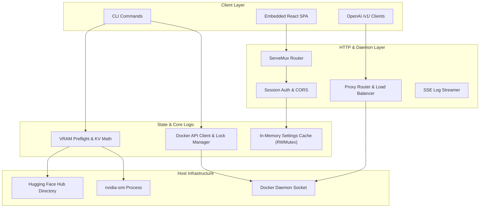

# System Architecture

A deep technical dive into the design and internal subsystems of **vLLM GPU Manager**.

---

## High-Level Component Design

---

## 1. Concurrency & State Management

### Mutex Locking & Copy-on-Write
- The settings cache in [`settings.go`](file:///home/amish/projects/vllm-gpu-manager/settings.go) is protected by a reader-writer mutex (`settingsCacheMu sync.RWMutex`).
- Readers on the hot proxy path (`getSettings()`) take an `RLock` and receive deep copies via `cloneSettings()`, preventing allocations from mutating global state.
- Model operations (download, start, delete) acquire per-model string mutexes (`getModelOperationLock(hfCache, model)`), ensuring that concurrent requests for the same model cannot cause race conditions while independent models execute in parallel.

---

## 2. Docker Execution Model

The backend communicates with Docker directly over the Unix domain socket (`/var/run/docker.sock`) using the official Moby SDK (`github.com/moby/moby/client`):

1. **Explicit Device Specification**: GPU assignments are rendered as `device=0,1` rather than global `--gpus all`.
2. **Standard Volume Mounts**: Hugging Face cache is mounted read-write as `/hf_cache` with environment variable `HF_HOME=/hf_cache`.
3. **Bridge Networking & IPC**: Serving containers use bridge networking (`--network bridge`) with explicit port publishing (`-p <host_ip>:<port>:<port>`) and `--ipc=host` for high-throughput PyTorch shared memory allocations.

---

## 3. Real-Time Log Streaming via SSE

Container log streaming (`/api/models/logs/stream?container_id=...`) utilizes Server-Sent Events (SSE):

- A long-running goroutine connects to Docker's multiplexed stream (`cli.ContainerLogs`).
- Standard output and standard error are demultiplexed via `stdcopy.StdCopy`.
- Chunks are flushed immediately using `http.Flusher`.
- When the browser disconnects, the request context (`r.Context().Done()`) cancels the stream goroutine immediately, releasing Docker reader sockets.
