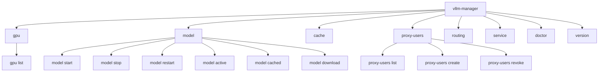

# CLI Overview & Headless Operations

**vLLM GPU Manager** features a standalone Command Line Interface (CLI) built on Cobra. Every feature available in the web console can be executed directly from the terminal over SSH without running the web daemon.

---

## Command Hierarchy

---

## Global CLI Conventions

- **Structured Output**: All listing and inspection commands accept `--json` for shell scripting, jq piping, and automation.
- **Root-Safe & Non-Root Execution**: Runs under standard user accounts or system service accounts (`vllm-manager`) without requiring root access if the user belongs to the `docker` group.
- **Direct Engine Execution**: CLI commands communicate directly with the Docker Engine socket and `nvidia-smi` without requiring the web daemon to be active.
