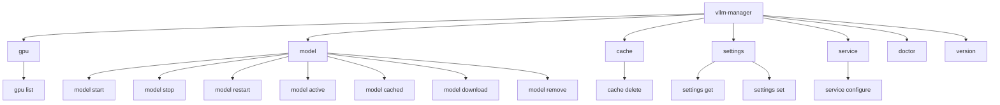

# CLI Overview & Headless Operations

**vLLM GPU Manager** features a standalone Command Line Interface (CLI) built on Cobra. GPU inspection, model lifecycle, downloads, cache cleanup, settings, diagnostics, and service configuration all run directly from the terminal over SSH without the web daemon. Proxy users, the routing table, and container log streaming are managed from the dashboard.

---

## Command Hierarchy

---

## Global CLI Conventions

- **Structured Output**: All listing and inspection commands accept `--json` for shell scripting, jq piping, and automation.
- **Root-Safe & Non-Root Execution**: Runs under standard user accounts or system service accounts (`vllm-manager`) without requiring root access if the user belongs to the `docker` group.
- **Direct Engine Execution**: CLI commands communicate directly with the Docker Engine socket and `nvidia-smi` without requiring the web daemon to be active.
