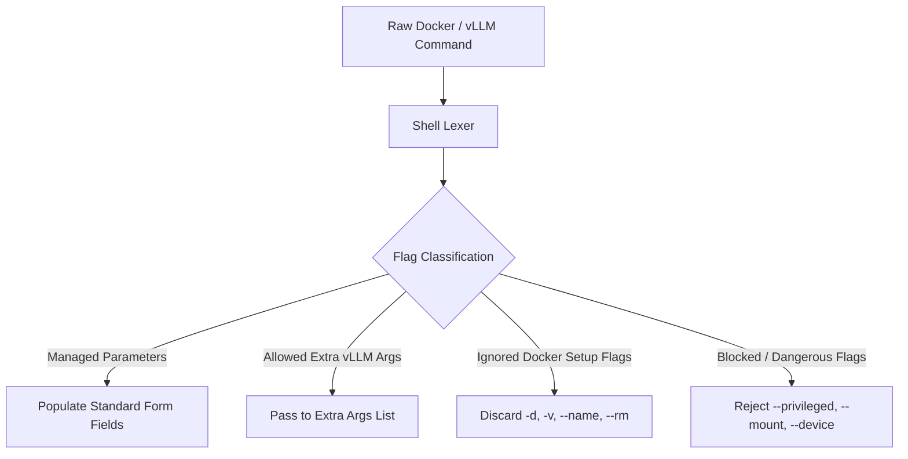

# Command Import & Recipe Parsing

vLLM GPU Manager includes an intelligent parser that converts arbitrary `docker run ...` or `vllm serve ...` commands into structured parameters.

---

## Using the Import Modal

1. Open the web console and click the **Import Command Recipe** button at the top of the **Deploy Server** card.
2. Paste any shell command recipe:

```bash
docker run --gpus '"device=0,1"' \
  --ipc=host \
  -p 8000:8000 \
  -v ~/.cache/huggingface:/root/.cache/huggingface \
  vllm/vllm-openai:v0.23.0 \
  --model meta-llama/Llama-3.3-70B-Instruct \
  --tensor-parallel-size 2 \
  --max-model-len 16384 \
  --kv-cache-dtype fp8 \
  --tool-call-parser hermes \
  --reasoning-parser deepseek_r1 \
  --enable-chunked-prefill \
  --chat-template /opt/template.jinja
```

3. Click **Import into Form**. The parser populates the standard deploy inputs, separates manager-owned flags, and attaches allowed extra parameters to the launch request.

---

## Security & Flag Filtering Rules

To prevent container escape vulnerabilities or configuration drift, the parser applies strict rules:



### 1. Managed Parameters
Flags mapped directly to form controls:
`--model`, `--served-model-name`, `--port`, `--tensor-parallel-size`, `--pipeline-parallel-size`, `--gpu-memory-utilization`, `--max-model-len`, `--max-num-seqs`, `--cpu-offload-gb`, `--dtype`, `--kv-cache-dtype`, `--tool-call-parser`, `--tokenizer-mode`, `--reasoning-parser`, `--moe-backend`, `--speculative-config`, `--trust-remote-code`, `--enable-expert-parallel`.

### 2. Allowed Extra vLLM Flags
Safe runtime tuning flags preserved in `extra_vllm_args`:
- `--chat-template`, `--chat-template-content-format`, `--response-role`
- `--max-num-batched-tokens`, `--max-num-partial-prefills`, `--max-seq-len-to-capture`, `--max-logprobs`
- `--enable-chunked-prefill`, `--enable-prompt-embeds`, `--enforce-eager`
- `--disable-log-requests`, `--disable-log-stats`
- `--guided-decoding-backend`, `--rope-scaling`, `--rope-theta`
- `--block-size`, `--swap-space`, `--scheduler-delay-factor`

### 3. Blocked Dangerous Flags
Flags that attempt to modify container capabilities or networking are stripped and surfaced as warnings:
- `--privileged`, `--network`, `--entrypoint`, `--mount`, `--cap-add`, `--device`, `--security-opt`
