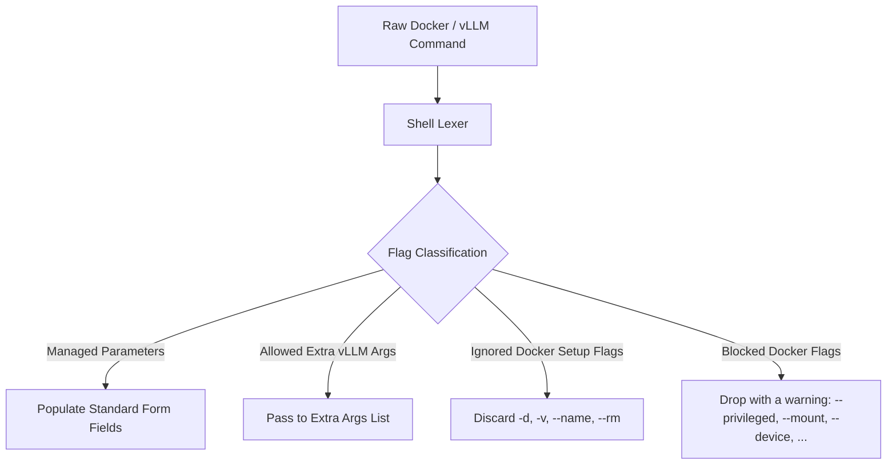

# Command import

Paste a `docker run ...` or `vllm serve ...` command you already use, and the dashboard fills in the deploy form from it. Flags the manager does not support, or that would loosen container security, are not imported.

---

## Import a command

1. On **Models**, click **Import Command** on the **Deploy Server** card.
2. Paste the command:

```bash
docker run --gpus '"device=0,1"' \
  --ipc=host \
  -p 8000:8000 \
  -v ~/.cache/huggingface:/root/.cache/huggingface \
  vllm/vllm-openai:v0.23.0 \
  --model meta-llama/Llama-3.3-70B-Instruct \
  --tensor-parallel-size 2 \
  --max-model-len 16384 \
  --kv-cache-dtype fp8 \
  --tool-call-parser hermes \
  --reasoning-parser deepseek_r1 \
  --enable-chunked-prefill \
  --chat-template /opt/template.jinja
```

3. Click **Import Command**. The form is filled in, and a review lists every flag that was ignored or rejected and why.

---

## What gets imported

The parser sorts every flag it sees into one of four groups. These rules come from `api/command_import.go`.



### 1. Managed Parameters
Flags mapped directly to form controls:
`--model`, `--served-model-name`, `--port`, `--tensor-parallel-size`, `--pipeline-parallel-size`, `--gpu-memory-utilization`, `--max-model-len`, `--max-num-seqs`, `--cpu-offload-gb`, `--dtype`, `--kv-cache-dtype`, `--tool-call-parser`, `--tokenizer-mode`, `--reasoning-parser`, `--moe-backend`, `--speculative-config`, `--trust-remote-code`, `--enable-expert-parallel`, `--enable-prefix-caching`, `--no-enable-prefix-caching`.

These are recognised but ignored, because the manager owns them: `--host`, `--api-key` (with a warning), `--enable-auto-tool-choice` and `--disable-frontend-multiprocessing`.

### 2. Allowed Extra vLLM Flags
Flags without a dedicated form field are kept in `extra_vllm_args` only if they are on this allowlist of 29. Anything else is reported as unsupported and is not imported.

- With a value: `--max-num-batched-tokens`, `--max-num-partial-prefills`, `--max-long-partial-prefills`, `--long-prefill-token-threshold`, `--max-seq-len-to-capture`, `--max-logprobs`, `--chat-template`, `--chat-template-content-format`, `--response-role`, `--generation-config`, `--guided-decoding-backend`, `--rope-scaling`, `--rope-theta`, `--limit-mm-per-prompt`, `--mm-processor-kwargs`, `--scheduler-delay-factor`, `--swap-space`, `--compilation-config`, `--override-generation-config`, `--override-pooler-config`, `--hf-overrides`, `--block-size`
- Without a value: `--disable-log-requests`, `--disable-log-stats`, `--enable-chunked-prefill`, `--enable-prompt-embeds`, `--enforce-eager`, `--language-model-only`, `--no-enable-flashinfer-autotune`

The allowlist is enforced again when a model launches, so extra arguments sent straight to the API are checked the same way as imported ones. A flag that the manager already owns, or one that is not on the list, is rejected.

### 3. Docker Flags
Flags that would change what the container is allowed to do are not imported. Each one is listed as unsupported, with a warning that the manager owns the Docker security settings:

`--privileged`, `--network`, `--entrypoint`, `--mount`, `--cap-add`, `--device`, `--pid`, `--user`, `--security-opt`, `--restart`

Other Docker flags are handled as follows:

- `--gpus` and `-p` / `--publish` are read, to fill in the GPU selection and the port.
- `-v` / `--volume` is ignored with a warning, because the manager uses its configured Hugging Face cache.
- `-e` / `--env` is not imported (a warning is shown), except `HF_HOME`, which is ignored without one.
- Setup flags such as `-d`, `--rm`, `--name`, `--ipc` and `--shm-size` are ignored.
- Any other flag is reported as unsupported.
