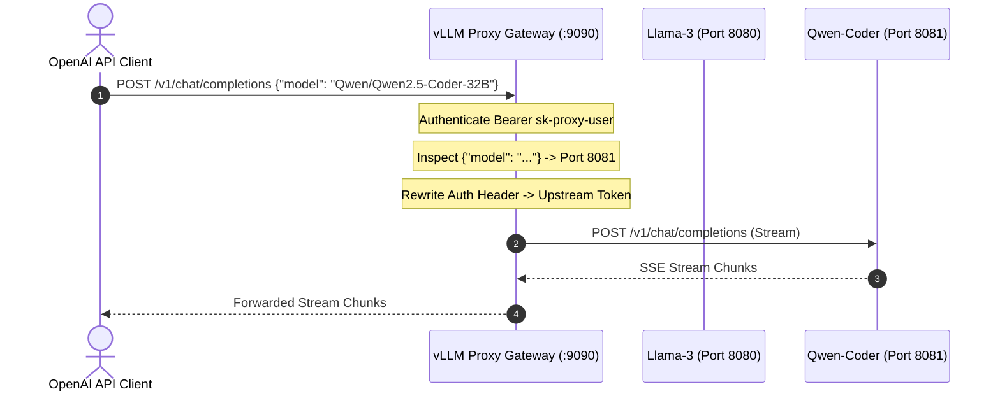

# Traffic Routing & Proxy Gateway

The built-in reverse proxy gateway allows external clients and applications to connect to a single OpenAI-compatible endpoint without tracking underlying container ports.

---

## How the Gateway Works

When the dashboard daemon is running (default port `9090`), the `/v1/` endpoint acts as a smart reverse proxy:



---

## Managing Proxy Users & API Keys

Generate named API keys for developers, applications, or downstream services:

### Creating a User Key
- **Web Console**: Go to **Proxy Gateway** $\rightarrow$ **Create Proxy User**.
- **CLI**:
  ```bash
  vllm-manager proxy-users create analytics-service
  ```

Output:
```text
Created proxy user: analytics-service
API Key: vllm_proxy_5f8a92b3c1d4...
```

### Revoking a User Key
```bash
vllm-manager proxy-users revoke analytics-service
```

---

## The Routing Table

The routing table maps model names and custom aliases to local ports:

```json
{
  "meta-llama/Llama-3.3-70B-Instruct": 8080,
  "llama3": 8080,
  "Qwen/Qwen2.5-Coder-32B-Instruct": 8081,
  "coder": 8081
}
```

When an active container is launched or stopped, the routing table updates automatically. You can also view or edit custom alias routes on the **Traffic Routing** page or via CLI:

```bash
vllm-manager routing list
vllm-manager routing set "gpt-4-turbo" 8080
```

---

## Querying `/v1/models`

Sending a `GET` request to `/v1/models` returns all currently routed models in standard OpenAI format:

```bash
curl http://localhost:9090/v1/models \
  -H "Authorization: Bearer <your-proxy-api-key>"
```

```json
{
  "object": "list",
  "data": [
    {
      "id": "meta-llama/Llama-3.3-70B-Instruct",
      "object": "model",
      "created": 1722384000,
      "owned_by": "vllm-manager"
    },
    {
      "id": "Qwen/Qwen2.5-Coder-32B-Instruct",
      "object": "model",
      "created": 1722384000,
      "owned_by": "vllm-manager"
    }
  ]
}
```
