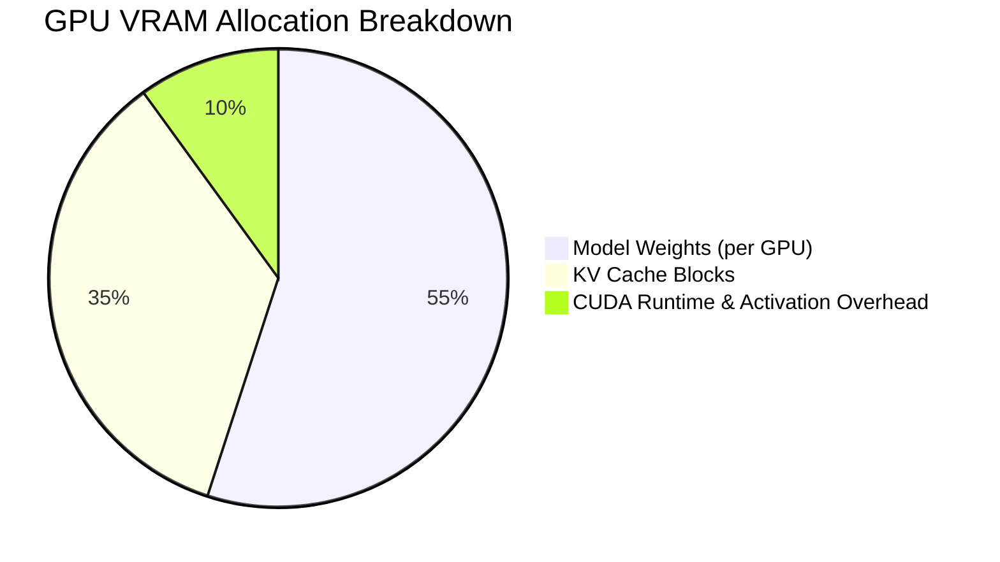

# VRAM Calculation & Safety

One of the defining features of **vLLM GPU Manager** is its strict, proactive VRAM preflight engine. This page explains how memory requirements are computed.

---

## The VRAM Formula

Total GPU memory required at launch is computed as:

```text
VRAM_total = VRAM_weights + VRAM_kv_cache + VRAM_overhead
```



---

## 1. Model Weight Memory

Model weight size is read directly from cached `safetensors` and `bin` files on disk:

```text
Weight Bytes per GPU = (Total Model File Bytes / GPU Count) * 1.08
```

The `1.08x` factor accounts for non-tensor metadata, memory alignment, and activation buffers during CUDA initialization. If CPU offloading is requested (`--cpu-offload-gb`), that value is subtracted from the weight requirement.

---

## 2. KV Cache Memory per Token

When a model is downloaded, vLLM GPU Manager reads its `config.json` (resolving revision hashes in `refs/main` or `snapshots/`) to extract architectural hyperparameters:

- `L`: Number of hidden layers (`num_hidden_layers`)
- `H_kv`: Number of key-value attention heads (`num_key_value_heads`)
- `D_head`: Dimension per attention head (`head_dim` or `hidden_size / num_attention_heads`)
- `B_element`: Bytes per KV element (2 bytes for 16-bit, 1 byte for FP8)

For a single GPU in tensor parallelism:

```text
KV Heads per GPU = ceil(H_kv / TP_Size)
KV Bytes per Token per GPU = 2 * L * KV Heads per GPU * D_head * B_element
```

### Example: Llama-3.1-70B (TP=4)
- Layers `L = 80`
- KV Heads `H_kv = 8` -> `8 / 4 = 2` KV heads per GPU
- Head Dimension `D_head = 128`
- 16-bit element size `B_element = 2` bytes

```text
KV Bytes/Token/GPU = 2 * 80 * 2 * 128 * 2 = 81,920 bytes/token (~80 KiB/token)
```

For a context length of 32,768 tokens:

```text
Total KV Cache per GPU = 81,920 * 32,768 = 2,684,354,560 bytes (~2.50 GiB)
```

---

## 3. Launch-Time Preflight Checks

Before Docker creates the container, the backend executes:

1. **Context Limit Check**: Rejects `--max-len` values that exceed the model's native context window limit (`max_position_embeddings`).
2. **KV Head Divisibility Check**: For tensor parallelism, confirms that `num_key_value_heads` is divisible by the GPU count (skipping MLA architectures like DeepSeek).
3. **Compute Capability Check**: Rejects FP8-quantized checkpoints on GPUs with compute capability below 8.9 (e.g. Volta, Turing, Ampere).
4. **VRAM Fit Check**: Verifies that:
   ```text
   Weight Bytes/GPU + Min KV Cache Floor (1 GiB) <= Allocated Budget
   ```
5. **GPU Overlap Check**: Confirms that:
   ```text
   Sum(mem_util_active) + mem_util_new <= 1.00
   ```
