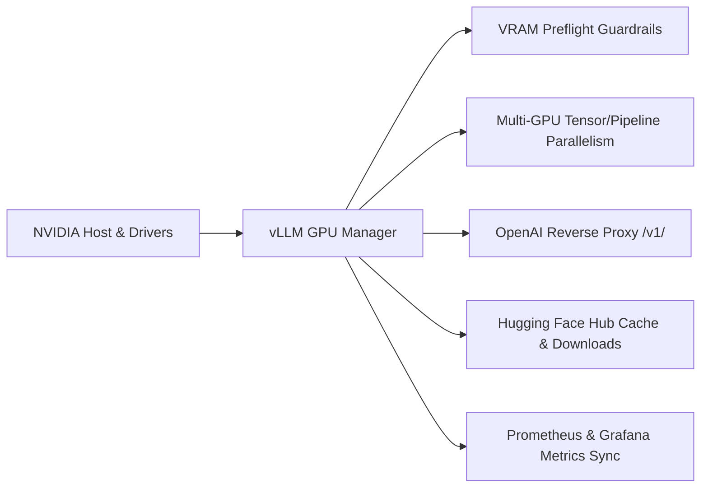

# vLLM GPU Manager

**vLLM GPU Manager** is an open-source, single-binary CLI and web management console for running [vLLM](https://github.com/vllm-project/vllm) OpenAI-compatible inference servers inside isolated Docker containers on NVIDIA GPU Linux hosts.

This project is intentionally focused and operations-centric. It is not a distributed Kubernetes cluster scheduler, a heavy desktop AI studio, or a cloud orchestration platform. It is an internal infrastructure tool for dedicated GPU servers where administrators need strict VRAM preflight validation, fine-grained multi-GPU placement, Hugging Face cache management, and a dynamic OpenAI reverse proxy.

---

## Core Capabilities

- **VRAM Launch Preflight**: Calculates model weights, KV cache memory per token, and context length limits before launching containers, preventing costly runtime CUDA out-of-memory (OOM) crashes.
- **GPU Placement Controls**: Configure tensor parallelism (`--tensor-parallel-size`), pipeline parallelism (`--pipeline-parallel-size`), and pin exact GPU device IDs (`--gpu-ids 0,1`).
- **Dynamic OpenAI Proxy Gateway**: Reverse proxy on `/v1/` that maps requested model names to live container ports, enforces Bearer token authentication, tracks per-user request counts, and rewrites upstream tokens.
- **Hugging Face Cache Management**: Inspect downloaded model directory sizes, track background download container progress, and safely purge cached models via sandboxed helper containers.
- **Single-Binary & Native Packaging**: Ships as a standalone Go binary with an embedded React web application (`go:embed`), and native `.deb` (Debian/Ubuntu) and `.rpm` (RHEL/Rocky/Fedora) packages.
- **Operational CLI**: Every dashboard capability is accessible via CLI commands (`vllm-manager model start ...`) for SSH-first headless automation.
- **Systemd & Monitoring**: Systemd service integration with isolated user permissions and automatic synchronization of active server ports into Prometheus file-SD targets.

---

## Architecture at a Glance

| Component | Technology | Responsibility |
| :--- | :--- | :--- |
| **CLI & Daemon** | Go 1.23+ | Direct container lifecycle execution, VRAM calculations, REST API, `/v1/` reverse proxy. |
| **Web Console** | React 19 + Vite | Embedded frontend with real-time SSE log streams, VRAM preflight visualizer, and hardware metrics. |
| **Container Runtime** | Docker Engine API | Creation, monitoring, and health checking of standard `vllm/vllm-openai` containers. |
| **Hardware Telemetry** | `nvidia-smi` | GPU temperature, VRAM utilization, process lists, and PCIe/NVLink topology. |
| **Telemetry Sync** | Prometheus File-SD | Mirrors live vLLM Prometheus metrics endpoints to `vllm-targets.yml`. |

---

## System Requirements

### Host Environment
- **Operating System**: Linux (AMD64 or ARM64).
- **GPU**: NVIDIA GPUs with Pascal or newer architectures (compute capability $\ge 6.0$; compute capability $\ge 8.9$ recommended for native FP8).
- **Driver**: NVIDIA Linux driver supporting your required CUDA version.
- **Docker**: Docker Engine 20.10+ with the **NVIDIA Container Toolkit** (`nvidia-container-toolkit`) installed and configured as the default or selectable runtime.
- **Tools**: `nvidia-smi` available in the system `PATH`.

---

## Next Steps

- **[Installation Guide](./getting-started/installation.md)**: Install the binary, Debian package, or RPM package.
- **[Quickstart Guide](./getting-started/quickstart.md)**: Deploy your first LLM server in under 5 minutes.
- **[Core Concepts](./getting-started/core-concepts.md)**: Learn about container exposure modes, VRAM budgets, and the proxy gateway.
