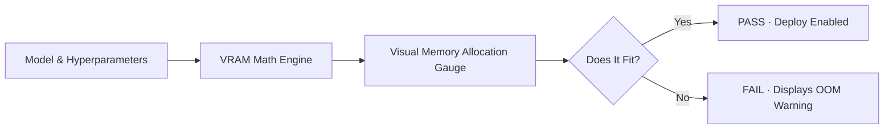

# Deploying Models (Web Console)

The **Deploy Model** modal in the Web Console allows operators to configure, preflight, and launch vLLM serving containers with real-time feedback.

---

## The Deploy Model Modal

Click the **Deploy Model** button on the dashboard to open the interactive deployment modal:

  

    DEPLOY MODEL MODAL
    vLLM GPU Manager
  

  

---

## Interactive VRAM Preflight Meter

As you enter the model name and configure parameters (Port, GPU Count, Memory Utilization, Max Context Length), the modal recalculates the memory requirements dynamically:

- **Weight Footprint**: Reads cached safetensors size on disk and divides by selected GPU count.
- **KV Cache Allocation**: Computes exact KV memory per token and multiplies by the context ceiling (`--max-model-len`).
- **Safety Margin**: Adds a 1.08x multiplier for CUDA activation buffers and checks that the total does not exceed the target GPU's free memory.

---

## Advanced Options Accordion

Expanding the **Advanced Settings** accordion exposes deep vLLM tuning flags:

- **KV Cache Quantization**: `auto`, `fp8_e4m3`, `fp8_e5m2`.
- **Weight Data Type**: `auto`, `bfloat16`, `float16`.
- **Parallelism Strategy**: `tensor` (TP) or `pipeline` (PP).
- **CPU Offloading**: Offload weights to system RAM (`--cpu-offload-gb`).
- **Structured Outputs**: Hermes, Mistral, or Llama 3 tool-call parsers.
- **Reasoning Parsers**: DeepSeek R1 / DeepSeek V4 reasoning token extractors.
- **Command Importer**: Paste raw `docker run` commands to auto-populate form inputs.
